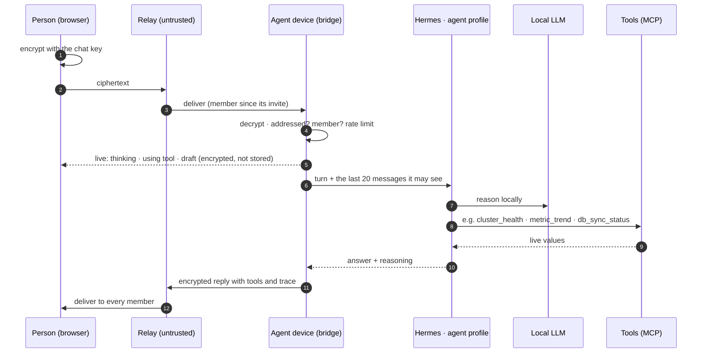

# Sovereign Agents

On-prem proof of concept: end-to-end encrypted chat where every person brings their own AI
agents. Every model (LLM, speech-to-text, text-to-speech, embeddings) runs locally on one Mac
(M4 Max, 36 GB). The relay only ever sees ciphertext, and no prompt, transcript or document goes to
a cloud AI service.


## What it shows

- **E2E group chat for 4 people.** Browsers keep their own device keys. Each chat has a key that is
  replaced on every membership change, and the relay stores and forwards ciphertext only (the app
  shows exactly what the relay holds).
- **Personal agents.** Each person creates agents from a template (General, DevOps, QA), gives them
  a personality and invites them into chats. An agent is a chat member with its own device key: it
  reads only chats it was invited to, from the moment of the invite.
- **Ask with @.** `@Ops is anything about to go wrong in the cluster?` The agent answers on the local
  model through Hermes Agent and calls tools over MCP. Under every reply, anyone in the chat can
  open its reasoning and each tool call (arguments and result).
- **Ops bots on a local model.** DevOps and QA agents read a simulated ops backend (nodes, raft,
  database replication, user presence, QA runs, tickets). Real GitLab, Jira and Confluence plug in
  the same way later.
- **Memory with boundaries.** Each agent has a private memory space; agents share only inside a chat
  they are both in.
- **Testers from anywhere.** `make demo` serves everything from the Mac, and `make share` publishes it
  on a Tailscale tailnet over HTTPS.

## One question to an agent



## Who can see what

| Part | Sees | Never sees |
|---|---|---|
| Relay | chat and device ids, sizes, times | keys, message text, file names |
| An agent | chats it was invited to, from the invite on; its own memory | earlier messages, other agents' memory, other chats |
| Agent tools | the allowlist of its template (MCP over the bridge) | Hermes built-in tools (terminal, files and web are off) |
| Models | prompts on this Mac | the internet (`make smoke` checks 0 bytes of egress) |

Actions with an external effect (sending on someone's behalf, publishing notes, triggering a
pipeline) will wait for the owner's approval (planned).

## Components

| Component | Path | Built with | Status |
|---|---|---|---|
| Web app | `apps/web` | React, Tailwind, libsodium | chat, agents, presenter view |
| Relay | `services/relay` | Node, WebSocket, SQLite | membership + signed tickets |
| Bridge | `services/bridge` | Node, Fastify, Postgres | directory, agent host, MCP server |
| Client engine | `packages/client` | TypeScript (browser + Node) | keys, encrypt/decrypt, sync |
| Protocol / crypto | `packages/protocol`, `packages/crypto` | zod, libsodium | |
| Hermes profiles | `infra/hermes` | Hermes Agent | one per agent, MCP only |
| Local LLM | `infra/models`, `config/models.yaml` | vllm-mlx, Qwen3.5 9B / Gemma 4 26B | |
| Memory | `services/memory` | Python, EmbeddingGemma 2, pgvector | service built, wiring next |
| Audio API | `services/audio-api` | whisper.cpp, Kokoro, Piper | service built, voice in chat next |
| Ops backend simulator | `services/ops-sim` | Node | stand-in for real systems |
| Live agent activity | bridge + web | ephemeral encrypted signals | pre-warm, live status, streaming drafts |
| Connectors, approvals, voice, calls | | MCP servers, LiveKit | planned |

## Measured on the demo Mac

| | |
|---|---|
| Ops bot answers on the local 9B model | 13–32 s, 2–7 tool calls each |
| LLM time to first token | 0.15 s |
| Speech-to-text, 11.9 s of audio | 1.07 s |
| Memory recall@3 (EN + FR/DE questions) | 40 / 40 |
| Memory used with every model loaded | 30.5 of 32 GiB |
| Egress during the smoke run | 0 bytes |

## Quick start

```bash
make prereqs   # checks host tools and prints install commands for anything missing
make install   # JS + Python dependencies
make models    # downloads every model in config/models.yaml (~30 GB, resumable)
make up        # local LLM, whisper, Postgres (PROFILE=fast|quality)
make seed      # the four demo users; prints their PINs once (.run/demo-pins.txt)
make dev       # relay, bridge, ops simulator, web on http://127.0.0.1:5173
```

Then open a few browser tabs, one user per tab:
1. Sign in, then go to **My agents → + New agent** (DevOps).
2. Create a chat, open **Members → Add one of your agents**.
3. Ask with `@Name`.

| Command | What it does |
|---|---|
| `make check` | lint + unit tests, no models needed |
| `make smoke` | live checks of every local model, egress and memory guards |
| `make e2e` | Playwright: four browsers, chat, files, agents (no Docker needed) |
| `make agents-smoke` | the DevOps bot answers on the local LLM through the app |
| `make demo` / `make share` | the whole demo, kept awake / published on your tailnet |

## Docs

- Design and decisions: [`docs/superpowers/specs/`](docs/superpowers/specs/)
- Plans per sub-project: [`docs/relay/plans/`](docs/relay/plans/)
- Approved screen mockups: [`docs/design/mockups/`](docs/design/mockups/)
